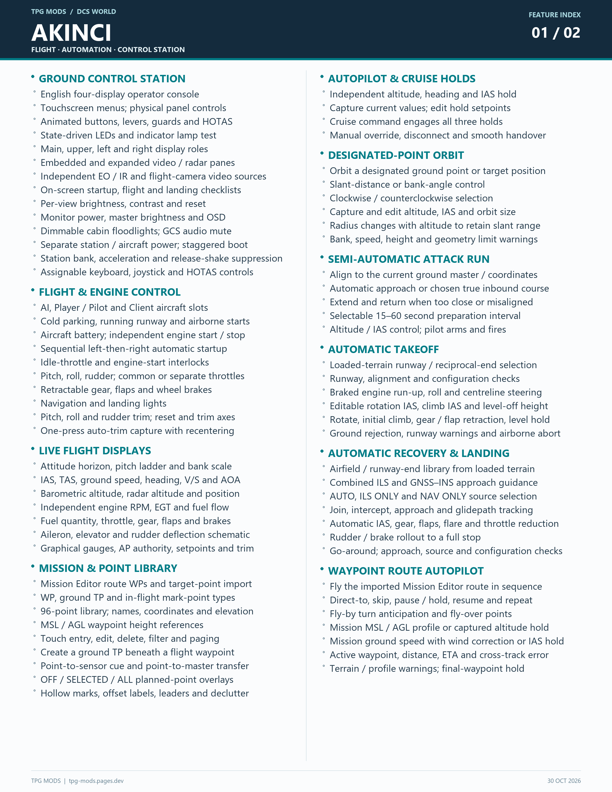
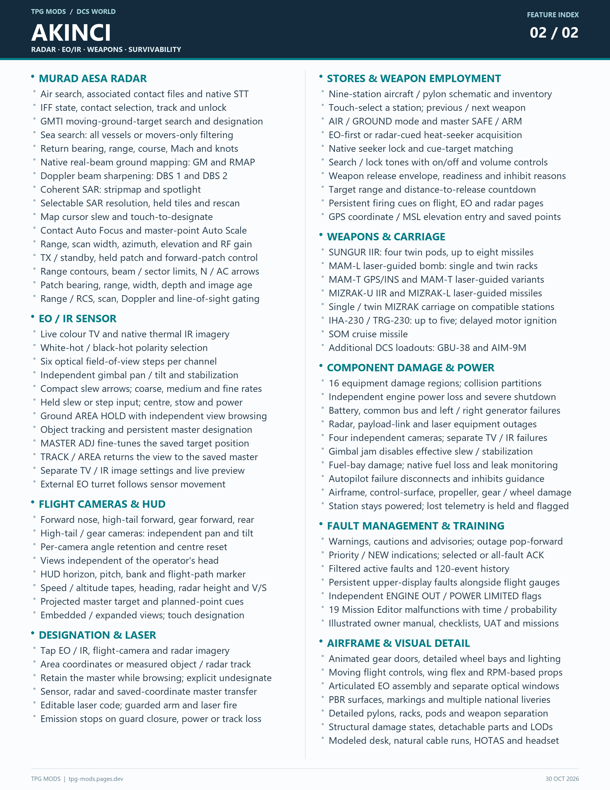

# AKINCI feature index

Two pages, two columns per page. Full-resolution 2550 × 3300 PNGs.

[View / download page 1](AKINCI_Features_01.png?raw=true) · [View / download page 2](AKINCI_Features_02.png?raw=true)

