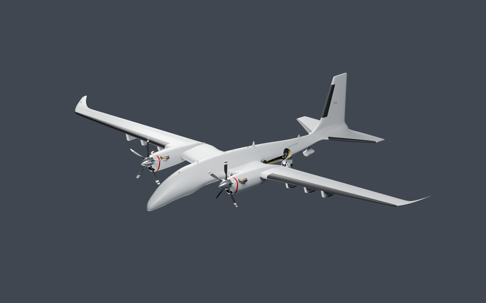
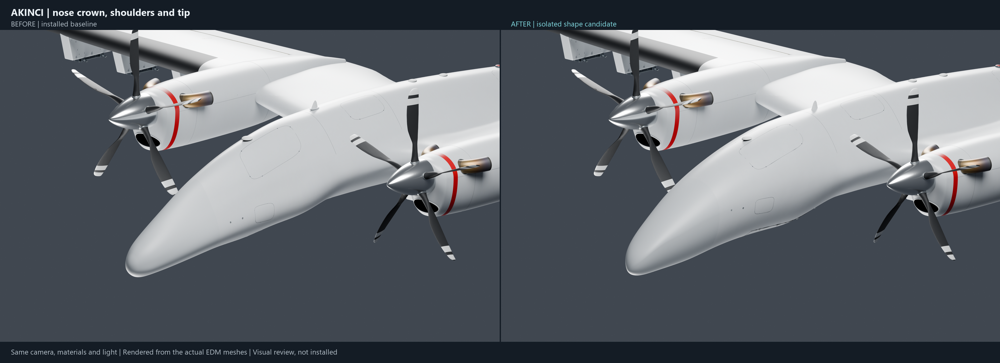
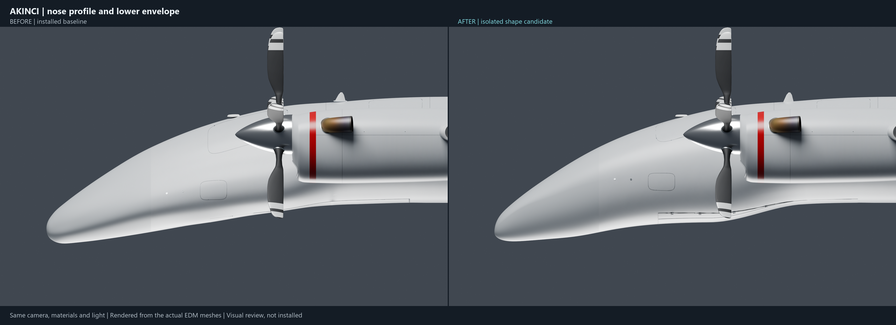
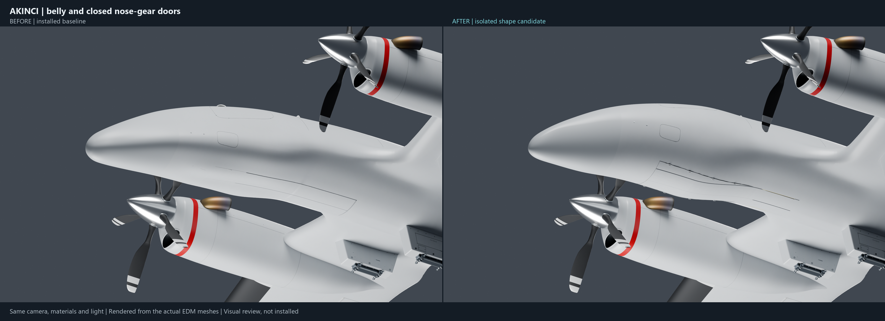
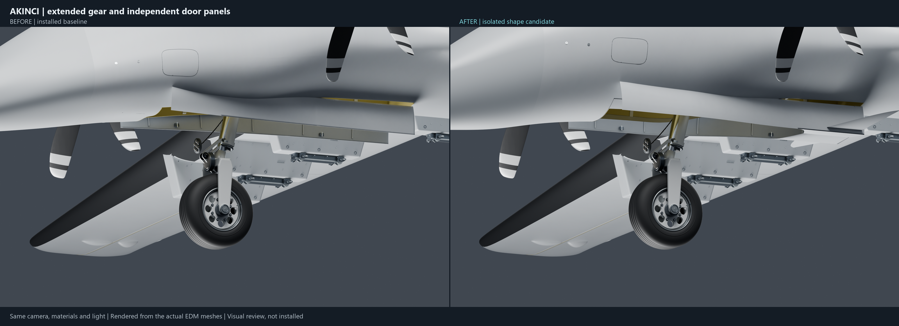
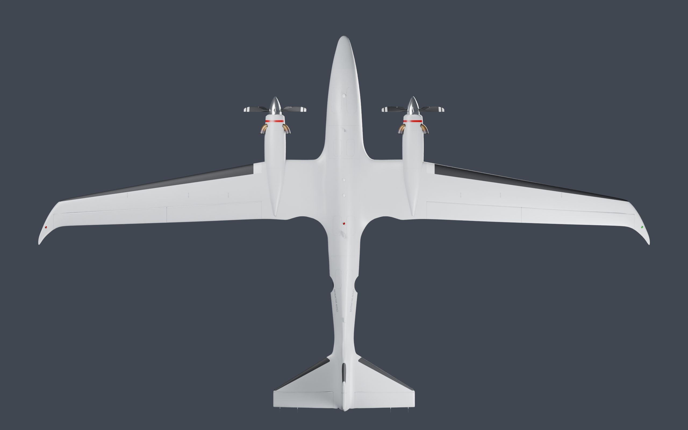
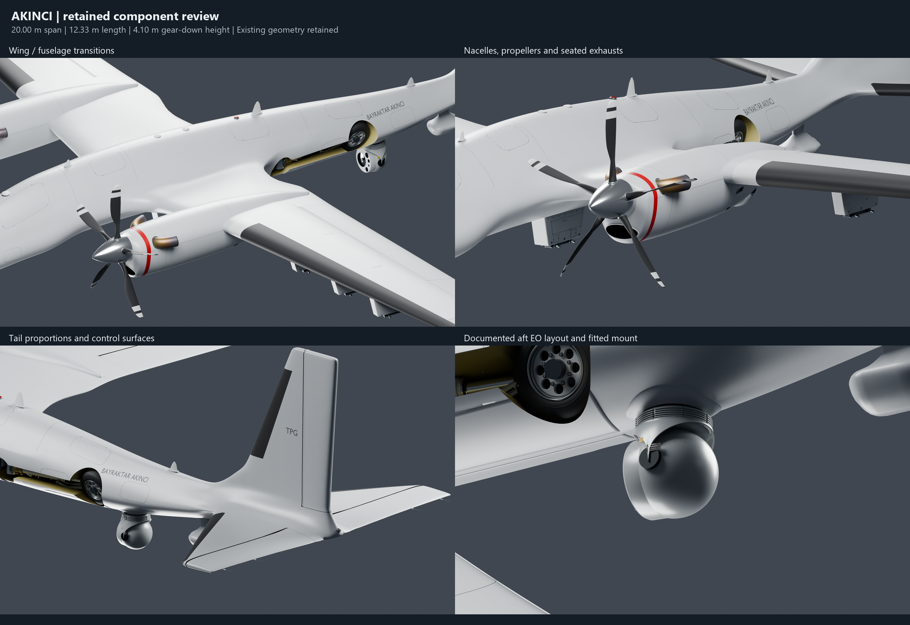

# AKINCI model review — 30 October 2026

An isolated visual candidate. The installed mod remains unchanged.

These are Blender/Cycles renders reconstructed from the actual baseline and candidate EDM meshes. They are not in-game screenshots or AI-generated aircraft images. Matched comparisons use identical cameras, lighting and materials.

The full airframe was reviewed. Measured dimensions are approximately **20.00 m span, 12.33 m length and 4.10 m standing height**. Existing wing, tail, nacelle, propeller and aft EO configuration geometry was retained. The visible changes are a rebuilt forebody surface, revised nose/belly profile, fair nose-door surfaces, and refitted adjoining forebody details. The original separate door outlines, topology, UVs and animation pivots are retained.

## Download individual PNGs

Open any link below and save the image. No ZIP or account login is needed.

- [Overall candidate — 2560 × 1600](https://raw.githubusercontent.com/Thepropergrip/TPG-Mods/akinci-model-review-20261030/review-assets/akinci-pro-20261030/01_AKINCI_Pro_Review.png)
- [Nose three-quarter: before / after — 3200 × 1164](https://raw.githubusercontent.com/Thepropergrip/TPG-Mods/akinci-model-review-20261030/review-assets/akinci-pro-20261030/02_Nose_Quarter_Before_After.png)
- [Nose side profile: before / after — 3200 × 1164](https://raw.githubusercontent.com/Thepropergrip/TPG-Mods/akinci-model-review-20261030/review-assets/akinci-pro-20261030/03_Nose_Profile_Before_After.png)
- [Belly and closed doors: before / after — 3200 × 1164](https://raw.githubusercontent.com/Thepropergrip/TPG-Mods/akinci-model-review-20261030/review-assets/akinci-pro-20261030/04_Belly_Doors_Before_After.png)
- [Extended gear and doors: before / after — 3200 × 1164](https://raw.githubusercontent.com/Thepropergrip/TPG-Mods/akinci-model-review-20261030/review-assets/akinci-pro-20261030/05_Gear_Extended_Before_After.png)
- [Full side profile — 2560 × 1600](https://raw.githubusercontent.com/Thepropergrip/TPG-Mods/akinci-model-review-20261030/review-assets/akinci-pro-20261030/06_AKINCI_Side_Profile.png)
- [Full top planform — 2560 × 1600](https://raw.githubusercontent.com/Thepropergrip/TPG-Mods/akinci-model-review-20261030/review-assets/akinci-pro-20261030/07_AKINCI_Top_Planform.png)
- [Retained components review — 2560 × 1760](https://raw.githubusercontent.com/Thepropergrip/TPG-Mods/akinci-model-review-20261030/review-assets/akinci-pro-20261030/08_Retained_Components_Review.png)
- [Candidate nose three-quarter close-up — 2560 × 1600](https://raw.githubusercontent.com/Thepropergrip/TPG-Mods/akinci-model-review-20261030/review-assets/akinci-pro-20261030/09_Nose_Quarter_Full_Size.png)
- [Candidate nose underside close-up — 2560 × 1600](https://raw.githubusercontent.com/Thepropergrip/TPG-Mods/akinci-model-review-20261030/review-assets/akinci-pro-20261030/10_Nose_Underside_Full_Size.png)

## Overall

## Matched close-ups

## Whole-airframe checks

## Scope and verification

The full installed baseline was copied and all **1,318 files** verified by SHA-256. The installed files were checked again after modeling and remain unchanged.

This candidate uses an explicit, editable forebody loft rather than another radial deformation of the installed nose. The native animation-node and connector records remain byte-identical. Cockpit scripts, flight model, cameras, weapon behavior and sounds were not changed.

**This is a visual review, not a release-ready mod.** In-game lighting and animation validation, LOD/destroyed-variant propagation, collision-shell fitting and damage appearance checks remain integration work. Do not install the main-model candidate alone over the mod.

Shape references include the user's supplied Blender model and [Baykar's official AKINCI material](https://baykartech.com/en/uav/bayraktar-akinci/). [Baykar's ASELFLIR test imagery](https://www.baykartech.com/en/press/turkiyes-new-advanced-drone-camera-undergoes-1st-test/) supports retaining the documented aft EO layout rather than mixing configurations from different aircraft.
