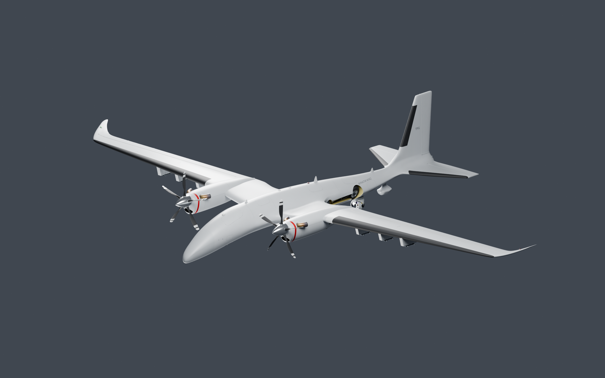
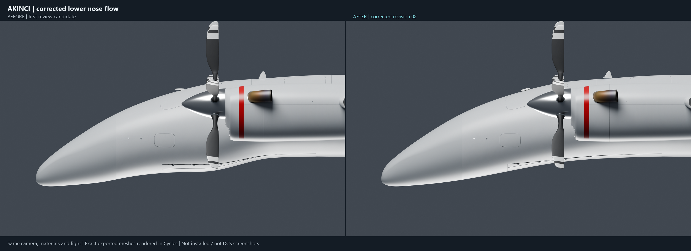
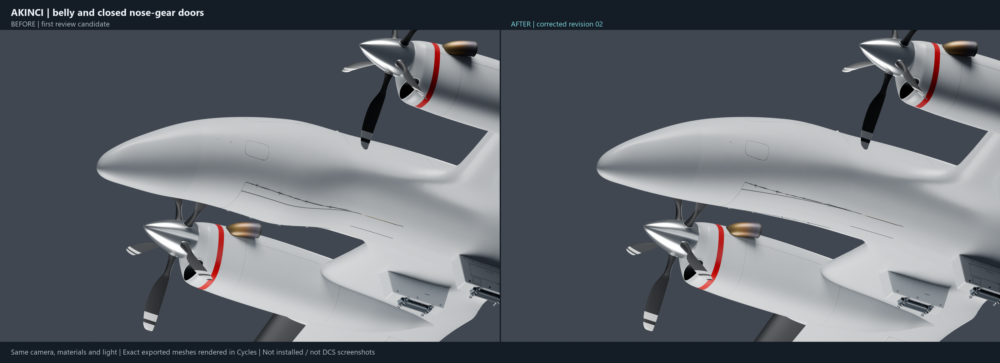
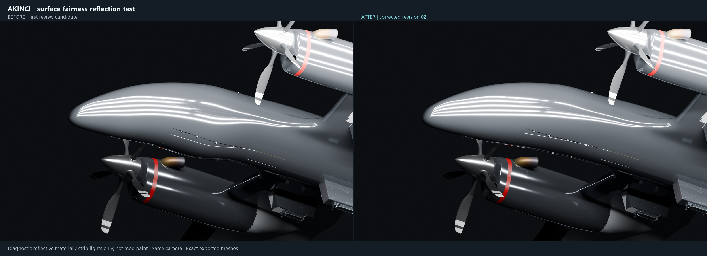
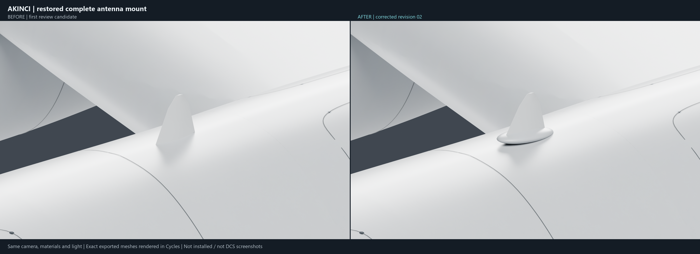
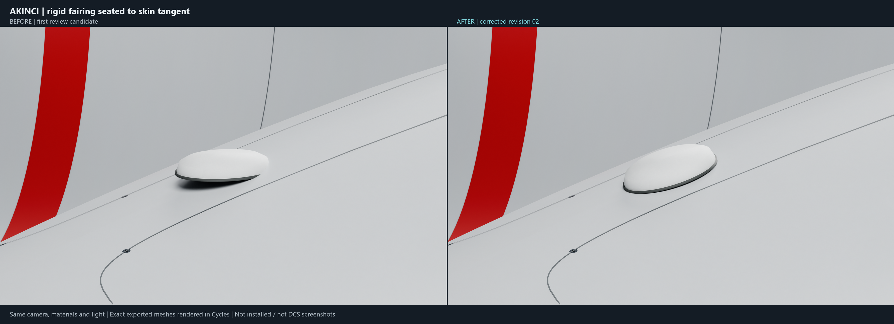
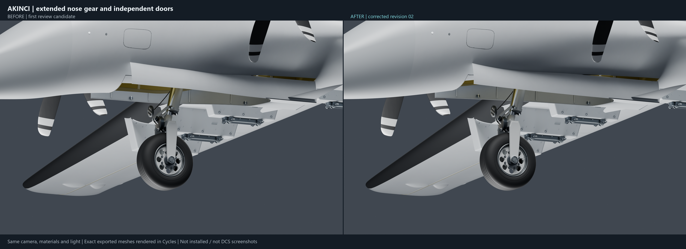
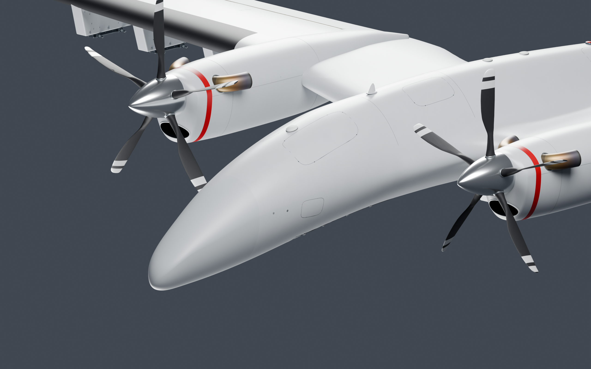
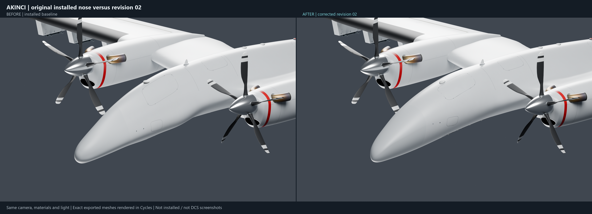
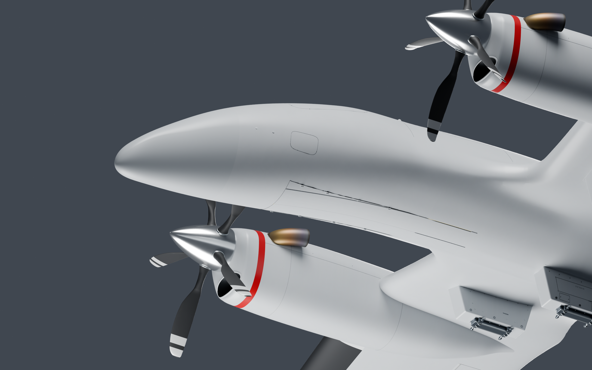

# AKINCI — corrected model review, revision 02

The self-review found and corrected a dip/plateau/dip in the lower nose, a deleted painted antenna base, and the small oval fairing’s seating angle. These are renders of the actual exported main EDM, reconstructed in Blender/Cycles. They are **not DCS screenshots**.

Original installed mod and the complete 1,318-file safe backup are unchanged. This is an isolated review candidate; native DCS acceptance, LOD/destroyed propagation and collision fitting remain integration work. No release was installed.

Click an image or its link for a standalone PNG. No ZIP or login is required for the raw files.

## Whole-airframe review

[Open/download PNG](01_AKINCI_Revision_02.png)

## Lower profile: first review versus corrected revision

[Open/download PNG](02_Lower_Profile_Comparison.png)

## Belly and closed nose doors

[Open/download PNG](03_Belly_Comparison.png)

## Reflection diagnostic (temporary reflective material; not mod paint)

[Open/download PNG](04_Reflection_Comparison.png)

## Restored complete antenna mount

[Open/download PNG](05_Antenna_Mount_Comparison.png)

## Rigid fairing seating

[Open/download PNG](06_Fairing_Seat_Comparison.png)

## Extended nose gear and doors

[Open/download PNG](07_Open_Gear_Comparison.png)

## Full-resolution nose close-up

[Open/download PNG](08_Nose_Closeup.png)

## Original installed baseline versus revision 02

[Open/download PNG](09_Original_Baseline_Comparison.png)

## Full-resolution underside

[Open/download PNG](10_Nose_Underside.png)

The before/after boards label whether BEFORE is the original installed baseline or the first isolated review. Same camera, lighting and materials are used on each neutral comparison. The reflection diagnostic deliberately substitutes reflective paint to reveal surface flow; it is not a new mod material.
