# AKINCI — revision 03 shape review

Revision 02 was rejected for remaining shape and door-seam defects. These PNGs show the revised isolated candidate reconstructed from its exported EDM. They are Cycles renders, not DCS screenshots. The installed mod and full safe backup are unchanged.

The nose now uses measured transverse reference curves, including the height of maximum breadth. The earlier guessed shoulder was about 20 cm too high in places. Longitudinal controls have been faired to avoid reproducing reference-mesh facets. Gear-door skins have been rebuilt separately with controlled thickness and gaps; the old doubled lip and derivative crease are removed. Rigid mounts and hinges are preserved separately from formed ribs and flexible seals.

The supplied model is a shape guide, not an authoritative CAD model or a replacement aircraft. Photos were used qualitatively; these are not photogrammetric accuracy claims. Whole top, side and front views are included so proportions remain inspectable.

Checks: 20,880 closed-surface samples, no unintended holes/steps above the 1.5 mm threshold; maximum sampled difference 0.435 mm. Door thickness 2.994–3.006 mm. Original fitting/hardware checks and native node/connector/shell preservation passed. All 1,318 installed and backup files retain their original hashes.

This remains a review candidate. Native DCS appearance, complete door kinematics, collision fitting, LOD and destroyed-model propagation are not certified by these renders.

## 01 AKINCI Revision 03

[Open / download full PNG](01_AKINCI_Revision_03.png?raw=true)

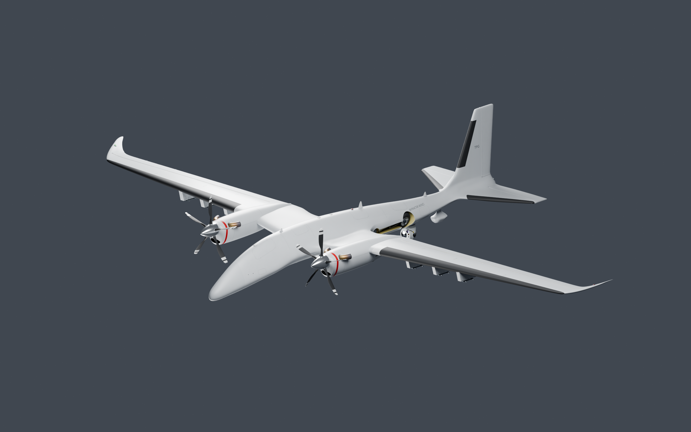

## 02 Nose Before After

[Open / download full PNG](02_Nose_Before_After.png?raw=true)

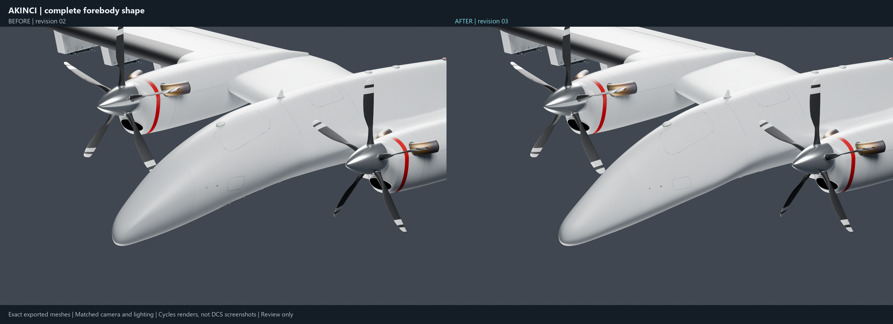

## 03 Door Before After

[Open / download full PNG](03_Door_Before_After.png?raw=true)

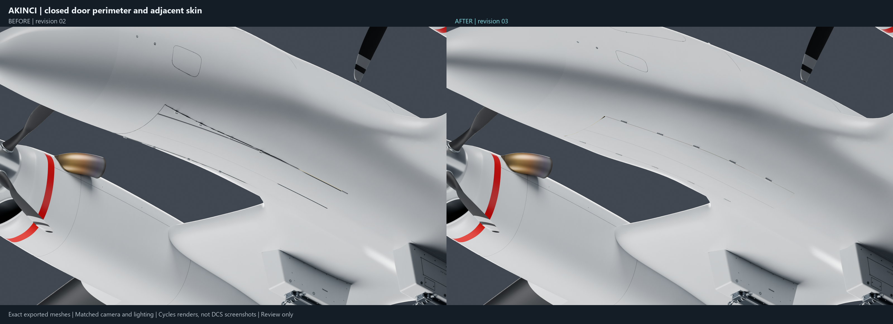

## 04 Front Reference Comparison

[Open / download full PNG](04_Front_Reference_Comparison.png?raw=true)

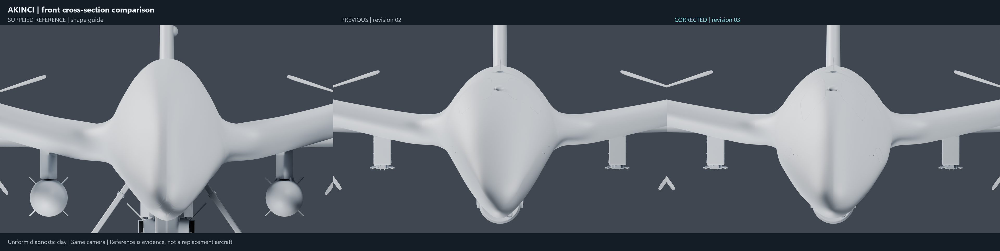

## 05 Side Reference Comparison

[Open / download full PNG](05_Side_Reference_Comparison.png?raw=true)

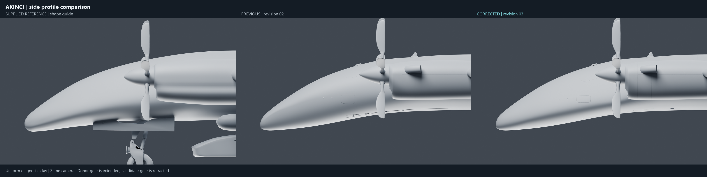

## 06 Reflection Comparison

[Open / download full PNG](06_Reflection_Comparison.png?raw=true)

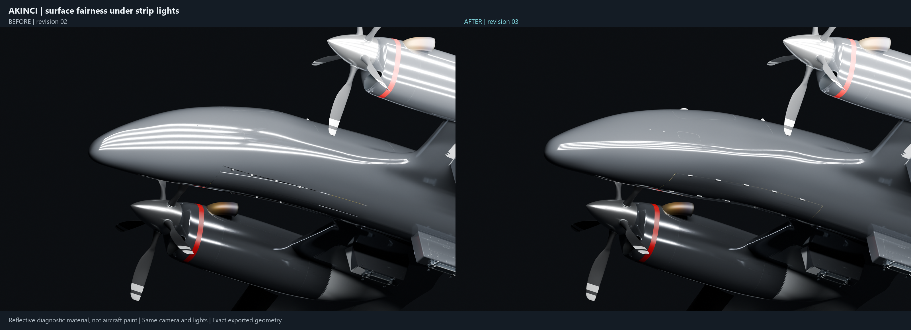

## 07 Gear Poses

[Open / download full PNG](07_Gear_Poses.png?raw=true)

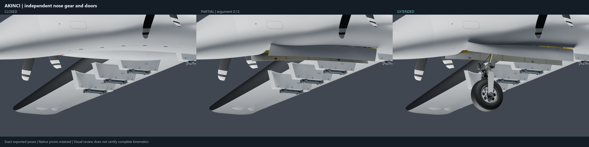

## 08 Nose Closeup

[Open / download full PNG](08_Nose_Closeup.png?raw=true)

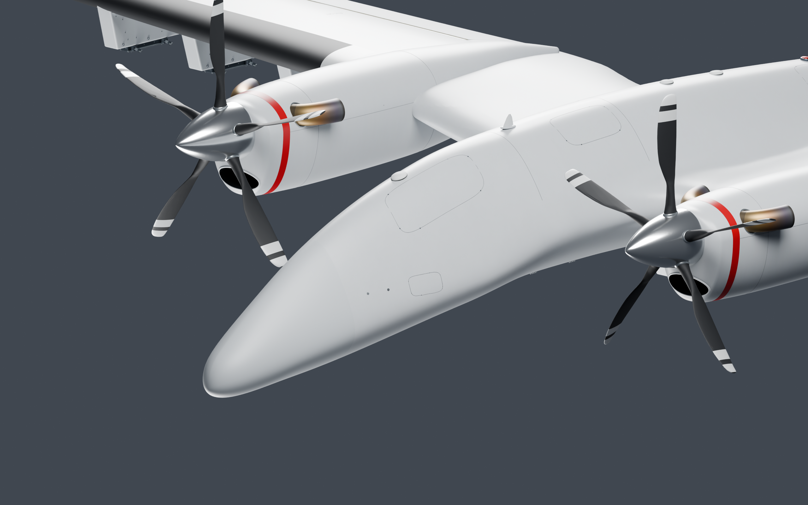

## 09 Door Closeup

[Open / download full PNG](09_Door_Closeup.png?raw=true)

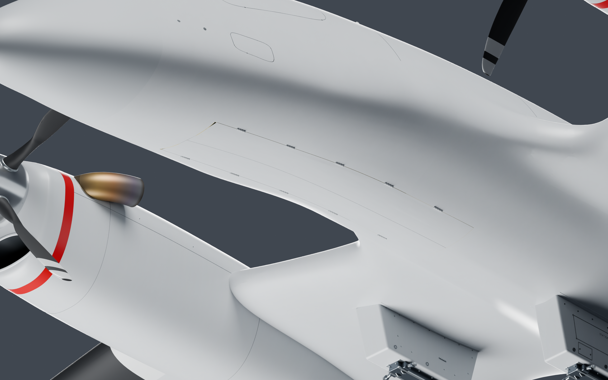

## 10 Whole Top

[Open / download full PNG](10_Whole_Top.png?raw=true)

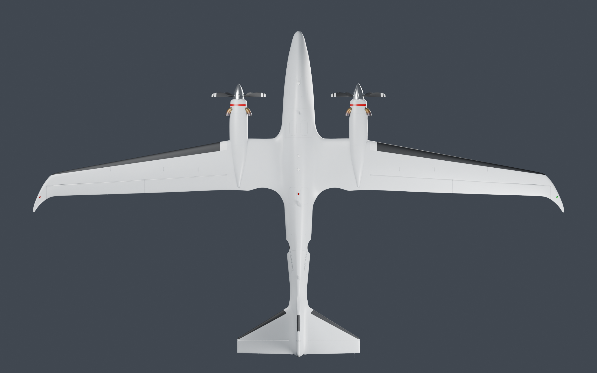

## 11 Whole Side

[Open / download full PNG](11_Whole_Side.png?raw=true)

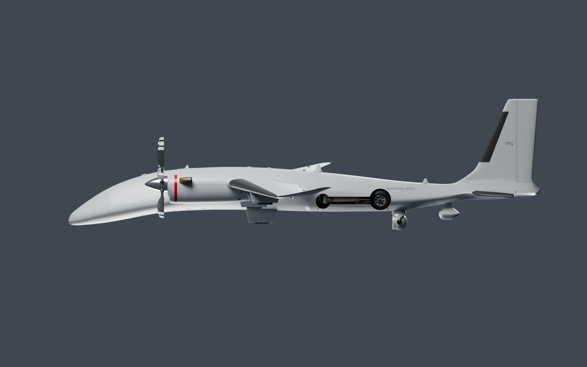

## 12 Whole Front

[Open / download full PNG](12_Whole_Front.png?raw=true)

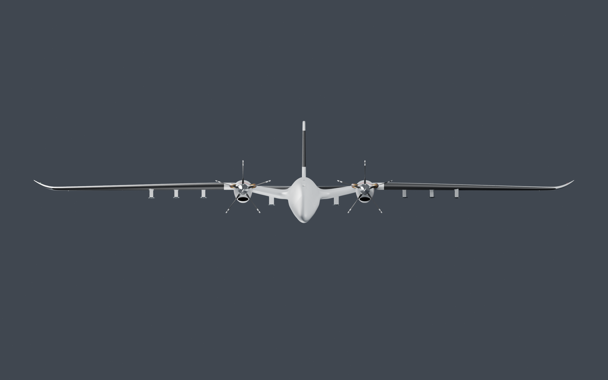

