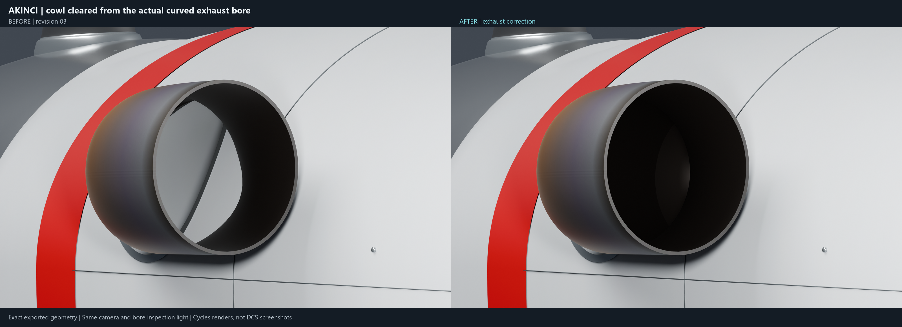
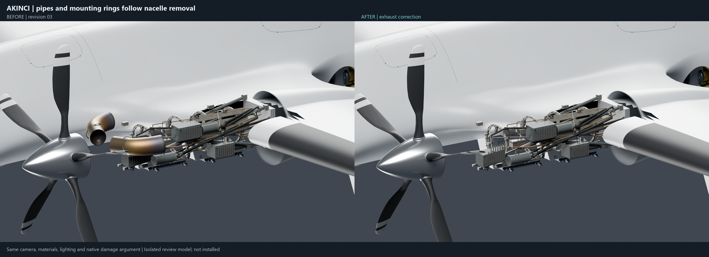
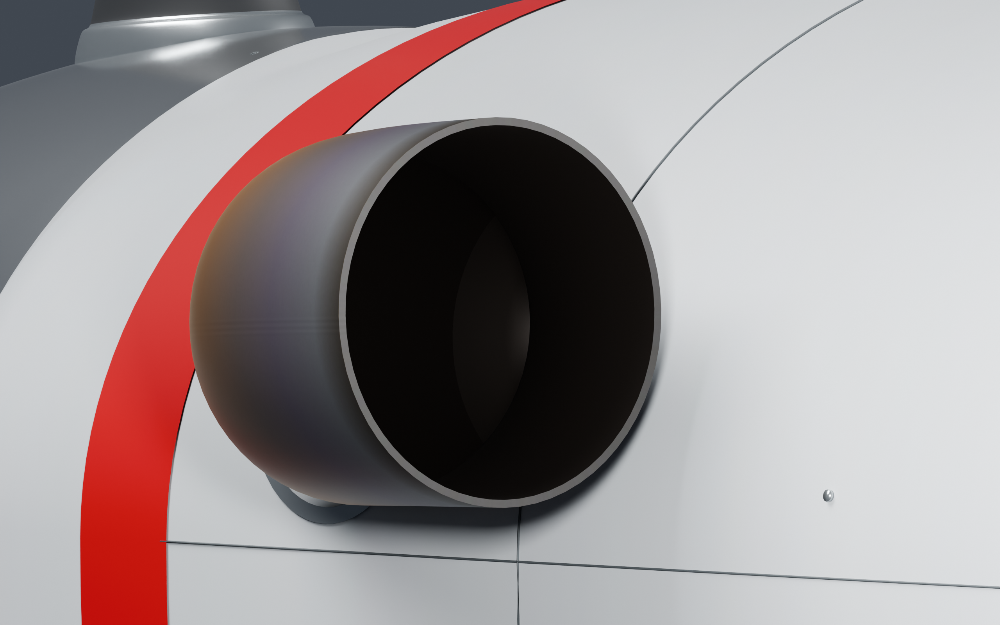
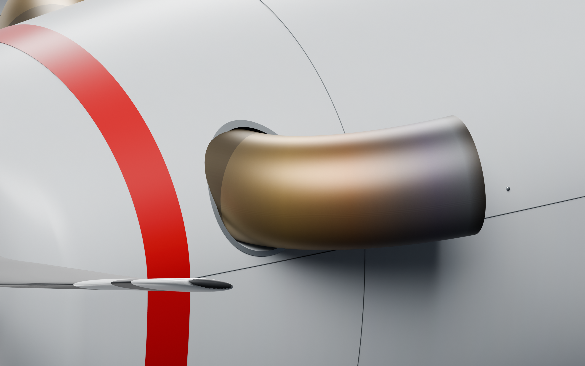
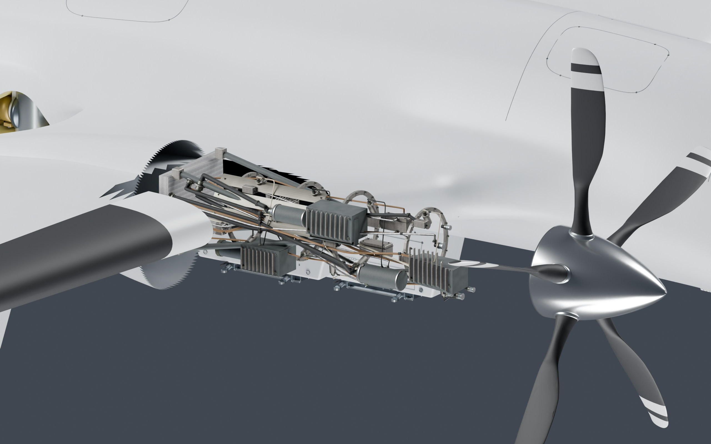

# AKINCI — exhaust correction, revision 04

Actual cowl intruded into the curved exhaust bores, and the pipes/root collars used wing-only damage visibility. This revision clears the bores, builds continuous inner liners, and makes the complete pipe/collar assemblies follow nacelle removal. At all three detail levels, detached exhausts are assigned to the nacelle pieces instead of the wing skeleton pieces.

The revision 03 nose and door geometry is retained byte-for-byte. [Whole-aircraft and nose review](../revision-03/README.md).

These are exact exported-model Cycles renders. The bore comparison uses identical cameras and an identical small inspection light to make internal obstructions visible. The damage comparison uses identical native damage argument values. They are not in-game captures or painted repairs.

The correction is in an isolated review copy. Installed mod and full safe base remain unchanged. Export checks cover 17 model files, three detail levels, both nacelles, visibility cases and oblique bore rays. Native DCS appearance and dynamic debris spawning remain unverified.

## 01 Exhaust Bore Before After

[Open/download PNG](01_Exhaust_Bore_Before_After.png?raw=true)

## 02 Damage Before After

[Open/download PNG](02_Damage_Before_After.png?raw=true)

## 03 Corrected Bore

[Open/download PNG](03_Corrected_Bore.png?raw=true)

## 04 Seated Exhaust

[Open/download PNG](04_Seated_Exhaust.png?raw=true)

## 05 Right Nacelle Removal

[Open/download PNG](05_Right_Nacelle_Removal.png?raw=true)

